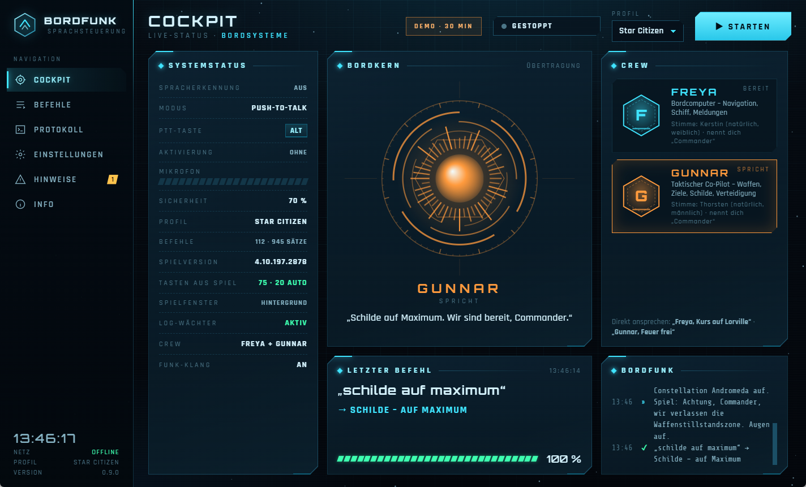
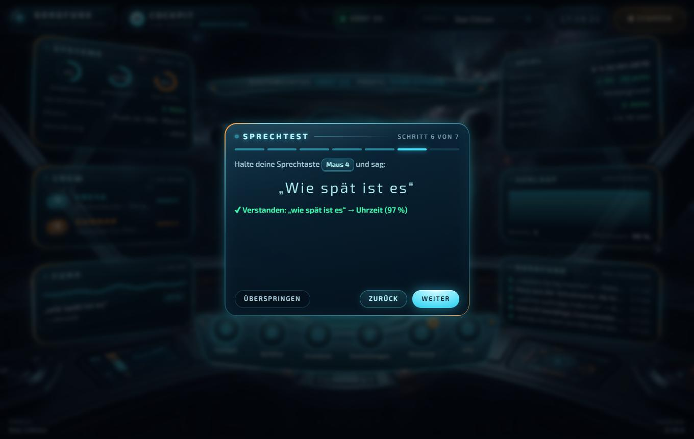
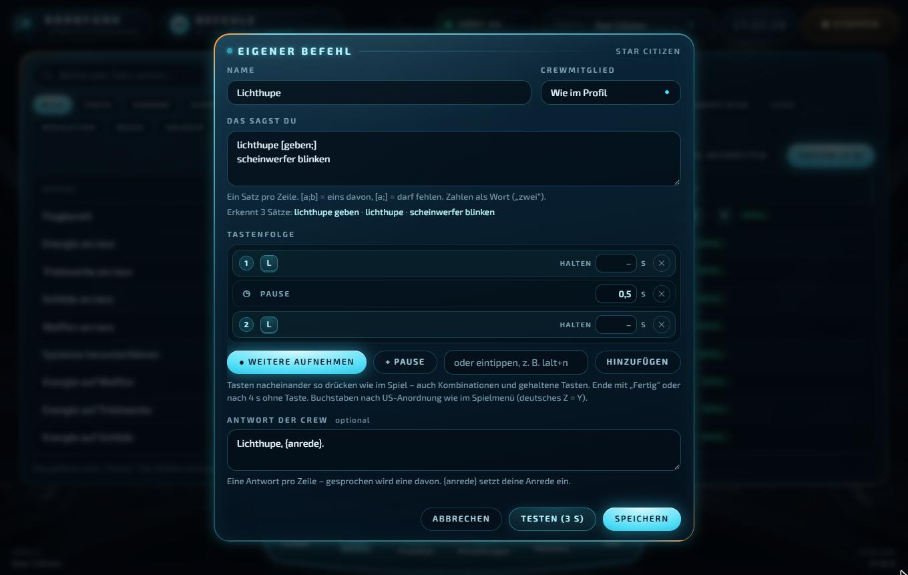
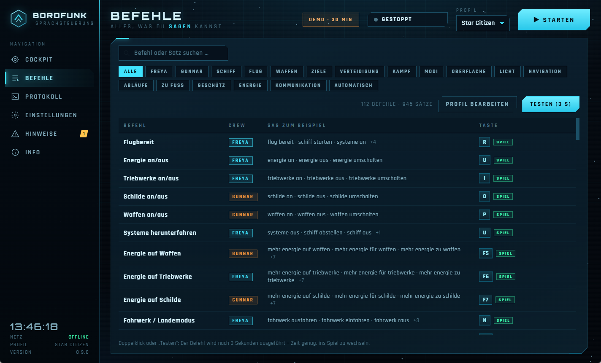
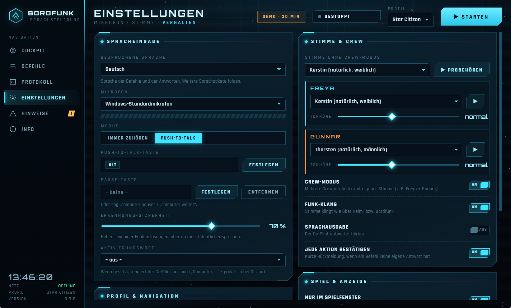

# BORDFUNK – Sprachsteuerung für Star Citizen

**Deine Crew hört mit.** Du sagst „Flugbereit“, „Schilde auf Maximum“ oder „Gunnar, Feuer frei“, und BORDFUNK drückt die passenden Tasten in Star Citizen. Zwei Crewmitglieder antworten mit eigener Stimme. Alles läuft **komplett offline**, ohne Konto, ohne Cloud und ohne Abo.

> **Kostenlos und ohne Zeitlimit.** BORDFUNK ist und bleibt kostenlos.
> **[⬇ BORDFUNK herunterladen](../../releases/latest)**

## Was BORDFUNK kann

- **Deine Crew:** **Freya** ist der Bordcomputer für Navigation, Schiff und Meldungen. **Gunnar** ist der taktische Co-Pilot für Waffen, Ziele und Verteidigung. Beide haben eine eigene, natürlich klingende Stimme mit Funk-Klang. Sprich sie mit Namen an, oder sag einfach den Befehl.
- **Versteht freie Sätze:** „Mach bitte das Licht an“, „Mehr Strom für die Waffen“, „Fahrwerk raus und Licht an“. Füllwörter und Reihenfolge sind egal.
- **Deine eigenen Tasten:** BORDFUNK liest die Tastenbelegung direkt aus deinem Star Citizen. Belegst du im Spiel etwas um, wird das sofort übernommen, auch nach Patches.
- **Mitwachsend:** Neue Spielfunktionen aus Patches bekommen automatisch einen Sprachbefehl.
- **Spielmeldungen:** Freya sagt Schutzzonen, Landefreigabe, Quantensprung-Ankunft und Warnungen in eigenen Worten an.
- **Gespräche und Spielwissen:** Plaudere mit Freya und Gunnar, oder frag sie etwas zum Spiel: „Freya, Frage: Wo finde ich Gold?“ (Stand 4.10).
- **Aufträge und Bordbuch:** „Welche Aufträge habe ich?“ nennt den nächsten Schritt, „Wie lief die Runde?“ fasst deine Runde zusammen.
- **Reise-Autopilot:** „Bring uns nach Lorville und lande dort“: Route, Quantensprung, Ankunft und automatische Landung, jeder Schritt erst nach deinem „bestätigt“. Ausrichten und Fliegen bleibt bei dir.
- **Raketen fertig machen:** Ein Satz, und Gunnar schaltet in den Raketenmodus und auf den nächsten Feind auf. Du musst nur noch schießen.
- **Checklisten und Musik:** Start-, Lande- und Sprung-Checkliste mit der Crew. „Nächstes Lied“ steuert Spotify oder den Browser im Hintergrund.
- **Bergbau und Signaturen:** Laser per Sprache steuern. Lies eine Radar-Signatur vor, und die Crew nennt das Erz.
- **Eigene Befehle:** Eigene Sprachbefehle in der Oberfläche anlegen, Tastenfolgen per Tastendruck aufnehmen.
- **Stream Deck:** Befehle per Knopfdruck, dazu Push-to-Talk.
- **Deutsch und Englisch:** Befehle, Antworten und Stimmen in beiden Sprachen.
- **Elite Dangerous:** Als zweites Spiel mit eigenem Profil.
- **Sicher:**
  - Gehaltene Tasten werden immer losgelassen, auch wenn du das Spielfenster verlässt.
  - Notausstieg und Schleudersitz laufen erst nach „bestätigt“.
  - „Feuer“ allein feuert nie.
- **Startet mit dem Spiel:** Auf Wunsch startet BORDFUNK automatisch, sobald Star Citizen läuft, und beendet sich danach.
- **Über 150 Befehle:** Flug, Energie, Schilde, Waffen, Ziele, Gegenmaßnahmen, Landung, Docking, Bergbau, Abläufe wie „Klar zum Start“ und Werkzeuge wie Uhrzeit oder Timer.

## Schnellstart

1. Die neueste ZIP-Datei unter **[Releases](../../releases/latest)** herunterladen und entpacken.
2. `Bordfunk.exe` starten.
   Erscheint „Der Computer wurde durch Windows geschützt“: auf **Weitere Informationen → Trotzdem ausführen** klicken.
3. Der **Einrichtungs-Assistent** führt dich durch Mikrofon, Sprechtaste (Push-to-Talk), Spielordner, Stimme und einen Sprechtest.
4. Im Spiel die Taste halten und sprechen. Ein paar Beispiele:

| Sag … | BORDFUNK macht |
|---|---|
| „Flugbereit“ | Systeme hochfahren |
| „Landeerlaubnis“ | Landung anfragen |
| „Fahrwerk ausfahren“ | Fahrwerk |
| „Schilde auf Maximum“ | Energie auf die Schilde |
| „Gunnar, Feuer frei“ / „Feuer einstellen“ | Dauerfeuer an und aus |
| „Ausweichen“ | Täuschkörper und Störsender |
| „Quantensprung“ | Quantensprung auslösen |
| „Raketen fertig machen“ | Raketenmodus an, nächsten Feind aufschalten |
| „Wie lief die Runde?“ | Rückblick auf deine Runde |
| „Frea, wie spät ist es?“ | Freya sagt die Uhrzeit |

Alle Befehle stehen im Programm unter **Befehle**.

## So sieht es aus

| | |
|---|---|
|  |  |
|  |  |

## Voraussetzungen

- Windows 10 oder 11 (64 Bit)
- Mikrofon oder Headset
- Etwa 700 MB freier Speicher
- Star Citizen (für die Tasten aus dem Spiel; ohne Spiel gelten die Standardtasten)

## Häufige Fragen

**Verändert BORDFUNK das Spiel?** Nein. Es liest die Tastenbelegung nur und sendet ganz normale Tastendrücke, wie eine Tastatur. Spieldateien werden nicht verändert.

**Verträgt sich BORDFUNK mit Easy Anti-Cheat?** BORDFUNK greift nicht auf das laufende Spiel zu. Es liest nur Dateien (Tastenbelegung und Game.log) und drückt Tasten wie eine Tastatur.

**Wo muss Star Citizen installiert sein?** Egal. BORDFUNK findet den Spielordner selbst. Falls nicht: **Einstellungen → Spiel & Anzeige → Star-Citizen-Ordner → Wählen …**

**Star Citizen stürzt nach längerer Zeit ab?** Steht in der Game.log kurz vor dem Absturz „left to commit“, ist der Windows-Speicher voll. Star Citizen braucht über Stunden 40 GB und mehr. Hilfe: die Auslagerungsdatei vergrößern (Windows-Taste → `sysdm.cpl` → Erweitert → Leistung → Einstellungen → Erweitert → Virtueller Arbeitsspeicher, z. B. 40960 bis 65536 MB).

**Braucht es Internet?** Nein. Spracherkennung und Stimmen laufen auf deinem PC.

**Welche Sprache?** Deutsch und Englisch (Einstellungen → Spracheingabe → Gesprochene Sprache).

**Kostet BORDFUNK etwas?** Nein, BORDFUNK ist und bleibt kostenlos. Wer mag, kann freiwillig spenden.

**Wie entferne ich BORDFUNK?** Falls eingeschaltet, zuerst „Mit dem Spiel starten“ ausschalten, dann den Ordner löschen. Sonst wird nichts installiert.

## Unterstützen

Wenn dir BORDFUNK gefällt, freue ich mich über eine kleine Spende über den **♥ Sponsor**-Knopf oben auf der Seite. Damit kann ich BORDFUNK weiterentwickeln: mehr Sprachen, mehr Spiele, neue Stimmen.

## Lizenzen und Hinweise

- BORDFUNK ist ein inoffizielles Fan-Projekt und steht in keiner Verbindung zu Cloud Imperium Games oder Frontier Developments. Star Citizen® ist eine Marke von Cloud Imperium Rights LLC, Elite Dangerous ist eine Marke von Frontier Developments plc.
- Die verwendeten Bestandteile und ihre Lizenzen stehen im Programmordner unter `lizenzen\`.
- Das Sprachmodul nutzt Piper und eSpeak NG (GPL-3.0). Sein Quelltext liegt unter `quelltext\`.

---

### English

**BORDFUNK** is an offline voice-control tool for Star Citizen (and Elite Dangerous) with a virtual two-person crew. It understands **German and English** voice commands. It reads your in-game keybindings, presses the keys for you, announces game events, tracks your contracts and recaps your session. No account, no cloud. Free, no time limit. Unofficial fan project, not affiliated with Cloud Imperium Games or Frontier Developments.
